I'm **Nitheesh**, a web developer who learns by building. I work with HTML, CSS and JavaScript, I'm learning Python, and I'm heading towards full-stack. I like turning real-world ideas, like my family's bricks business, into clean, working products.

**Also:** Student Performance Prediction (Python, scikit-learn) · Web Lab (small HTML/CSS/JS experiments)

<i>Learning in public. Building every day.</i>

